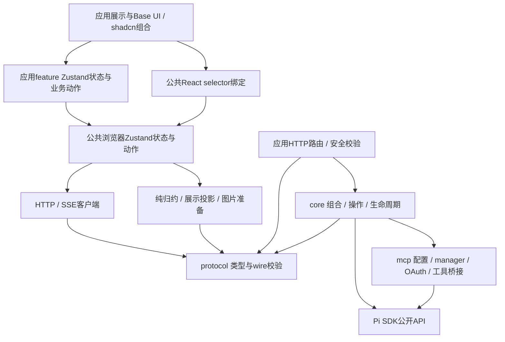

# R1：状态与资源所有权、目标架构

日期：2026-11-02。分类：feat（改变公共API、状态模型与模块组织）。研究基线：`ab19878`，业务源码与`5400b8f`一致；Pi SDK 1.4.0、协议14。

本文交付R1设计，等待方案确认；代码尚未实施。整改范围、步骤状态与问题关闭证据唯一维护在[子路线图](../../architecture-remediation-roadmap.md)。能力与历史证据依据[R0盘点](2026-11-02-test-architecture-remediation-inventory.md)，本文补齐该盘点所需的所有权与迁移去向，替代[启动研究](2026-11-02-feat-architecture-remediation-start.md)中的候选结构。

## 1. 目标与研究依据

前端业务状态、动作和订阅统一Zustand；删除Controller私有存储、aui运行时及分散模块store。Node服务按数据与资源持有者分解，保留Pi权威、信任与冷读、运行准入、结构互斥、MCP和认证边界。整个整改继续包含协议、业务、展示、性能、测试与文档。

本轮仅阅读源码、类型、测试和文档，修改Markdown；未运行应用、业务测试、构建或探针，未委派编码。以下为设计要求，不能作为已修复或已验证的结论。

| 已核对入口 | 当前证据与设计影响 |
| --- | --- |
| `packages/react/src/runtime/thread-controller.ts:473`及`use-harness-runtime.ts:90` | Controller持state/stateSnapshot、repository、三组listeners和资源；registry按访问累积。删除这套状态机制，保留有用算法与行为要求 |
| `apps/harness/src/components/workspace-context.tsx:126`、`workspace-sidebar.tsx:132` | Context目录/选择与aui目录/选择并存，侧栏合并ID和标题。目标只保留一份元数据实体 |
| `pi-composer-controller.ts:244`、模型/意图/bridge/认证模块 | 草稿、历史、请求与业务状态分布在hook、ref、单例和aui；全部分配到明确的Zustand所有者 |
| 设置/MCP/树/fork/import/运行操作/工作区/交互面板 | 查询代次、表单、busy/error和异步提交混在JSX。业务状态归store，展示只选择状态并调用动作 |
| `packages/core/src/host.ts:312/390/546/731` | prepared装配、record、发送与共享资源交叉持有。所有权先固定，再拆实现 |
| `host.ts:1248/2455/4233/4337`及末尾dispose | pending装配向record转移；删除、失败与退出各自执行收尾。统一资源转移和退休流程，保留不同文件处理规则 |
| `packages/core/src/mcp-host.ts`、`provider-auth.ts`、`packages/mcp/src/` | 已有broker、manager与OAuth边界。通过限定接口接入，不重写底层协议/连接体系 |
| `apps/harness/src/main.tsx`、`app.tsx`、`server/index.ts` | 浏览器启动与Node启动分别拥有最终销毁责任；Context不再创建业务状态副本 |

路径缩写：后文`R/`为`packages/react/src/`，`C/`为`packages/core/src/`，`A/`为`apps/harness/src/`，`H/`为`apps/harness/server/`，`P/`为`packages/protocol/src/`。目标文件均为拟议路径；现有路径在迁移表中单列。

## 2. 最终包与模块依赖



### 2.1 包入口

保留现有包，不新增浏览器包或通用RPC框架。`@huan/react`内部的transport/model/browser模块不导入React；只有React绑定需要React。Zustand通过`zustand/vanilla`提供实例，React通过`zustand`的selector绑定消费。

| 包/入口 | 最终公开责任 | 依赖限制 |
| --- | --- | --- |
| `@huan/protocol` | 各领域输入/结果/事件、领域接口组合、HTTP/SSE共用wire守卫与错误代码；不含URL路由表 | 无运行时外部依赖，无Node/React/Pi SDK |
| `@huan/react`根入口 | 浏览器实例工厂、独立输入/展示类型、React Provider与selector hooks | 根入口允许React；不导出Controller、aui extras/repository或内部资源表 |
| `@huan/react/client` | HTTP客户端、SSE连接/解码与transport错误 | 不导入React、Zustand业务store、应用或core；服务端测试不反向导入此入口取协议守卫 |
| `@huan/core` | `createHarnessHost`与必要领域错误/配置；组合领域能力 | 不依赖React或浏览器运行时；`@huan/core/testing`保持独立 |
| `@huan/mcp` | 现有配置、连接、认证与Pi集成公开接口 | 不反向依赖core/应用；使用官方公开入口 |
| `@huan/history` | 现有接口骨架 | 本轮不扩展文件快照能力 |

新增client子入口为实际应用transport消费者服务；model/browser维持包内模块，暂不新增无消费者的exports。导出直接指向源码，继续遵守开发期零构建约定。R8以静态导入检查保护上述方向，同时检查动态import、Node内置模块及assistant-ui生态残留；源码静态检查不替代浏览器生产构建。

### 2.2 浏览器目标目录

```text
packages/react/src/
  client/                 HTTP、SSE与transport错误
  model/                  thread-state、message-view、host-ui、image-input
  browser/
    create-browser.ts     组合实例、store与资源所有者
    service-store.ts      目录/会话/安全查询状态与服务动作
    window-store.ts       选择/草稿/附件/本窗提交与输入历史
    session-actions.ts    提交、停止、队列与结构动作
    resources.ts          连接/fetch/定时任务/帧调度的句柄
  react/                  Provider、字段selector与资源使用绑定
apps/harness/src/
  bootstrap.ts            client、浏览器实例、应用状态与销毁组合
  features/
    workspace/            工作区表单、信任、归属、列表控制
    composer/             内置命令路由、补全、长输入与应用动作
    sessions/             树/fork/clone/import/详情与删除确认
    settings/             设置编辑、资源查询与重载
    auth/                 provider/MCP面板与短期回填
    mcp/                  配置编辑、管理及按需详情
    runtime/              Shell/压缩/模型范围表单
    chat/                 最终展示组合、工具/data回退与滚动
  state/                  应用实例、主题与feature store组合
  components/ui/          Base UI基础组件
```

目录表示责任，允许同一领域在少量文件内实现。业务模块不导入JSX；展示可直接使用公开client执行无状态下载等动作，但涉及查询状态、异步业务与持久变更时必须进入所属store动作。不会为每个HTTP方法新增转发模块。

## 3. 浏览器状态所有权

### 3.1 实例与身份

`bootstrap.ts`创建一个client与`createHarnessBrowser({ client, connectionKey, windowId })`，再将实例传给React。`connectionKey`来自调用方配置的服务地址和凭证作用域标识，不包含token原文；读取HostInfo后，以agentDir和sessionStorage.root补充存储作用域。它们组合形成浏览器持久化命名空间，不新增服务端身份字段冒充已有协议能力。

每个嵌入根/窗口拥有独立实例。相同窗口中的多个视图可以显式共享实例；不同窗口通过Node服务同步权威数据。`windowId`继续用于定向交互，不作为权限依据；刷新可恢复，复制标签页的sessionStorage碰撞须由R2确定caller身份规则。UI本地`DraftTarget`的新会话目标须在创建前解析为显式workspaceId/startProjectPath，不依赖HTTP层补读窗口状态。

会话查看有明确的`cold`与`live`访问模式：冷快照、详情和树只读走catalog；正常打开的live视图沿用现有需装配的订阅行为，先经信任准入。元数据损坏时只允许cold；不为保持实时订阅而执行项目代码。现有`getThread`冷读与`subscribe → ensureOpen`的差异必须在最终API与UI中保留说明。

| Zustand所有者 | 创建者与作用域 | 唯一保存的业务数据 | 生命周期 |
| --- | --- | --- | --- |
| `serviceStore` | 浏览器实例创建；一个client/存储作用域 | HostInfo、工作区定义、唯一`threadsById`元数据、已加载`sessionDataById`、安全认证/启动交互快照、按目标的目录查询状态 | 实例销毁清空；作用域改变建立新实例，旧结果永久失效 |
| `windowStore` | 浏览器实例创建；当前UI窗口 | 显式选择、选择版本、创建目标、按草稿ID保存文字/附件/模型预选、提交记录、本窗输入历史、可恢复操作结果与定向指令应用记录 | 文字/选择按既有规则恢复；附件与提交资源仅内存；实例销毁释放 |
| 应用feature store | 应用实例按领域在首次使用时创建；同类面板复用一个store，以目标/面板ID索引 | 面板开关、目标/代次、表单与未保存草稿、搜索/过滤/选中/忙/错误、业务查询与操作结果 | 关闭使面板请求失效；未保存配置留当前窗口内存，显式丢弃或应用销毁清空 |
| 主题store | 应用bootstrap创建；当前浏览器文档 | theme选择与系统配色投影 | localStorage仅保存theme；storage/media监听由应用释放 |

选用一个规范化`serviceStore`，按会话字段选择订阅；不再为每个访问过的会话创建永久store或Controller registry。`threadsById[id]`保存协议元数据字段的唯一当前值，`sessionDataById[id]`保存消息、entryId对应、工具执行、交互、Shell、压缩详情、readiness与加载/连接状态。后者不复制metadata；运行status、模型/Thinking、contextUsage、队列等已在metadata表达的字段从该实体选择，复合运行展示由纯selector计算。压缩/重试活动标志也只保留一处，wire中重复字段在归约入口按R2规则解析。旧reducer返回的metadata和派生runStatus/queue不直接原样并存。

一次事件通过同一个Zustand `set`更新相关会话和元数据，避免跨store更新造成同一事件的短暂不一致。

目录扫描与会话事件均更新`threadsById`；扫描带开始版本，不能以旧扫描覆盖扫描期间变更的实体。列表过滤结果只存ID及查询状态，标题、归档和运行状态始终从实体读取。冷读缺少的字段与live字段如何合并由R2定义，不能把缺失当任意保留旧值。查询缓存每个目标/查询仅保留当前版本，推进资源或认证版本后释放旧结果，不让版本键永久累积；临时补全、目录与投影资源随所属目标释放。

### 3.2 数据、动作、持久化与失效

| 数据 | 唯一持有者/更新入口 | 失效与释放 | 持久化及保留要求 |
| --- | --- | --- | --- |
| 工作区/会话目录、健康状态 | serviceStore；refreshCatalog及工作区/会话变更动作 | 显式重扫、窗口聚焦；事件或操作完成按字段更新/失效，不靠DOM事件 | 服务端WorkspaceStore/Pi文件为权威；浏览器不persist目录 |
| 消息/模型/分支/运行/队列/Host UI/Shell | serviceStore会话数据；同一快照/事件归约入口 | stream epoch拒旧回调；完整快照替换规则由R2固定；视图切走不停止服务端 | Pi/record权威；不写浏览器历史副本；模型回退安全原因归此会话 |
| 当前选择/创建目标/侧栏展开/过滤 | windowStore选择与创建目标；workspace feature保存列表控制 | 每次显式选择推进selectionRevision；选择线程使用服务端threadId | sessionStorage保存选择/起始偏好/展开；无假会话ID、localId映射 |
| 草稿/模型预选/输入历史 | windowStore；editDraft、submit、restoreSubmission | 每次修改推进draftRevision，目标与草稿ID分开；历史仅由本窗已接受动作登记一次 | 文字按作用域/会话或空白目标保存；历史保持当前窗口内存及50项上限，不从共享user消息重建 |
| 附件/准备状态 | windowStore持附件ID、File/Blob和状态；图片准备动作 | 提交捕获附件引用；移除草稿引用不提前释放提交仍持有的内容 | 不persist附件/base64；预览URL由渲染资源持有；发送结果未知仍可找回 |
| 模型/命令/文件补全目录 | serviceStore共享模型/命令结果；composer feature持补全请求与选项 | 键含目标、resourceRevision、authRevision、modelCatalogRevision；参数补全/文件搜索再含输入版本与workspace revision | 换目标立即读新键的loading/error；旧目标缓存不参与新目标能力判断 |
| 设置/MCP原文与JSON草稿 | 对应feature store按目标+scope保存一个原文编辑源、baseContent/revision与draftRevision | 重读保留dirty草稿；显式丢弃才替换；保存响应只更新所属版本，不能盖后续编辑 | 原文按需读取，内存保留至丢弃/应用销毁；无persist/devtools/动作载荷日志；常用表单只编辑同一JSON源 |
| 资源文本、工具/资源详情、树与统计 | 所属feature store按目标及版本缓存 | 面板关闭终止只读请求；重开新panelEpoch；文本隐藏即清正文，详情/树关闭释放大结果 | 不persist全文/整棵树；隐藏正文只在用户再次请求时读取 |
| provider/MCP认证安全快照 | serviceStore；每种认证一个订阅/轮询所有者 | 根挂载启动发现，活动操作期间保持；面板关闭仍可接管；服务重启重建序列 | 不含凭据原文；目录随authRevision失效；退出环境凭据边界保留 |
| 回填/交互应答 | auth/session feature按operationId+promptId或requestId保存 | 提交、取消提示、目标失效、面板关闭即清空短期回填；请求忙/失败可见 | 不进入普通快照/消息/会话草稿/历史；editor保留prefill与多行 |
| 命令意图/树定位/fork/定向编辑器 | 直接调用所属store的带目标动作；windowStore保存可恢复结果 | 每项意图有ID、来源和消费状态；服务端领取与本地应用分别判断 | 旧草稿恢复内容仅当前窗口内存；迟到结果保留入口，当前选择保持用户后来决定 |
| 长输入、确认框、业务错误/忙 | composer或相应feature store | 长输入保存打开时draftRevision，应用时冲突提示；面板重开不认领旧请求busy | 不以useRef/useState隐藏表单或流程状态 |
| 展示投影、分组/搜索/排序 | 纯函数与按依赖缓存 | 输入引用/版本变更时更新；缓存随会话evict | 不可单独写回或作为发送来源；排序允许O(n log n)，索引和分组O(n) |
| 折叠/滚动意图/业务焦点目标 | chat feature/window状态；实际DOM句柄由组件持有 | 切会话按目标恢复，任务结束不改变用户主动滚动 | DOM测量/ref、hover、Base UI内部开关和IME组合中的DOM细节可用组件机制；共享业务开关归Zustand |

Zustand允许File/Blob等非JSON对象，统一状态管理不要求统一序列化。敏感store不挂调试中间件；安全诊断只允许明确字段。配置原文内存保留与现有关闭重开不丢草稿行为一致，关闭面板不宣称已经清除所有原文。

### 3.3 会话缓存与连接释放

已加载完整会话与目录实体分开释放。活动视图、在途本窗操作和打开的业务面板各有显式lease；仅活动live视图维持该会话长期SSE，cold视图保持只读fetch；后台操作需要观察终态时另持lease。目录行不为每个会话建立连接。切走后无lease则在微任务确认后关闭连接、删除消息/工具投影与完整会话缓存；同轮effect重新取得lease时取消释放。保留目录实体、窗口草稿和未解决提交记录。返回时从权威快照恢复。

删除成功后立即释放会话资源和缓存，清理该目标面板/持久文字键；删除结果未知时先重查，不能把网络断开等同成功。本窗有未解决提交时不丢其内容；用户显式丢弃或处理完成才移除。会话长时间运行不要求前端持续订阅，服务端继续执行；各窗口当前打开的会话仍保持空闲实时同步。

纯流式更新按帧合并到Zustand，连接层只缓冲未处理事件，不持有另一份完整可读业务状态；终结、交互、取消和错误事件立即先刷新缓冲。归约后保留未变引用，消息投影只重算变更段。其性能须按R0要求重新测量，不宣称换store自动变快。

## 4. 主要类型与业务动作

以下是R1职责草案，不作为已存在的API。R2将固定结果联合、字段与wire关联，实施时不保留旧API兼容层。草案中的协议类型从现有protocol引用；本地模式包含`command`时由应用解析后调用公共动作，不要求公共包理解应用命令目录。

```ts
type DraftTarget =
  | { kind: 'new'; workspaceId?: string; startProjectPath: string }
  | { kind: 'thread'; threadId: string }

type DraftRef = { draftId: string; revision: number }
type ViewOrigin = {
  selectionRevision: number
  panelId?: string
  panelEpoch?: number
}
type SubmissionCapture = {
  id: string
  target: DraftTarget
  draft: DraftRef
  origin: ViewOrigin
  content: string
  attachmentIds: readonly string[]
  model?: { provider: string; modelId: string }
  thinkingLevel?: HarnessThinkingLevel
  mode: 'prompt' | 'steer' | 'followUp' | 'bash' | 'bashExcluded' | 'command'
}
```

`SubmissionCapture`为本窗提交记录的一部分，只能由同步capture动作从当前store生成。附件File引用由提交记录与资源所有者按ID保留；每项异步操作获得不可变目标，不再读取“当前会话”补齐参数。`ViewOrigin`只限制完成时的窗口效果，不作为服务端权限依据。

| 公开动作归属 | 输入与责任 | 完成后的更新 |
| --- | --- | --- |
| 公共browser工厂 | 显式client/connectionKey/windowId；返回serviceStore/windowStore与使用lease、dispose | 只创建最终实例；React Context传实例，不复制其值 |
| windowStore选择/草稿 | selectTarget、editDraft、setDraftModel、add/removeAttachment、restoreSubmission | 推进本地版本、按白名单保存文字；选择不取消远端任务 |
| 公共session动作 | submit(capture)、stop(threadId)、recoverQueue(threadId)、respond(threadId, requestId, answer) | Zustand记录提交状态；权威事件更新服务数据；返回值不自行决定当前UI选择 |
| 公共结构动作 | navigate/fork/clone及label等，显式threadId/entryId/expectedRevision | 更新原会话或子会话实体，返回编辑文本/新ID；本窗应用由来源检查控制 |
| 应用composer动作 | 解析内置slash/Shell、打开业务面板、补全与长输入 | 内置交给feature动作，其余提交公共session动作；服务端仍保留保留命令守卫 |
| workspace/sessions feature动作 | 创建工作区/信任/归属/改名/归档/删除/导入/详情 | 写入后更新唯一目录；晚完成记录结果，按selectionRevision决定是否切换 |
| settings/runtime feature动作 | 读写设置、资源、模型范围、压缩、Shell、reload | 分开已保存值/live值/未保存草稿；共用目标版本与服务动作 |
| auth/mcp feature动作 | 登录/退出/回填/取消、配置保存、临时管理/详情 | 安全快照进入serviceStore，编辑与短期答案留feature；不建立第二套manager |

动作是Zustand创建时绑定的稳定函数，必要领域函数可拆文件实现。`session-actions.ts`只导出动作实现：提交capture及其接受/恢复状态绑定到windowStore动作，事件/目录归约绑定到serviceStore动作；相互通过组合根传入的有限读写能力调用。所有异步业务进度留在所属store，promise/AbortController只由resources持有。不以一个新的Controller类或万能业务对象重建私有状态。`HarnessClient`在R2拆为少量领域接口后组合供现有服务实现；调用者只取实际需要的领域类型，不为每个调用套一次转发。

服务store的数据轮廓为`{ host, workspacesById, threadsById, sessionDataById, queries, providerAuth, mcpAuth, hostInteractions }`；窗口store为`{ selection, selectionRevision, draftsById, submissionsById, inputHistory, recoverableResults }`。字典用服务端ID或本地草稿/提交ID索引；查询条目包含目标、依赖版本、requestEpoch、loading/error和结果。集合的具体字段联合在R2按现有wire能力确定，R3实现时按领域创建动作，避免把全部逻辑写进一个store文件。

## 5. 浏览器业务时序与迟到结果

### 5.1 首条创建与发送

1. windowStore同步capture目标、模型/Thinking、文字、附件ID、草稿版本和selectionRevision，登记提交。重复点击同一未变草稿使用已有在途记录；用户明确再次提交是新动作。图片准备可取消，开始后不读取新目标或新模型草稿。
2. 业务动作显式创建，信任与启动交互由独立服务交互通道承接。创建成功先记下threadId并更新唯一目录；已有`initialMessage`与分开发送两条当前路径在R2按接受结果可确认性核定为一条最终流程，R1不假定创建等于首条接受。
3. 已知threadId后仅向该会话发送。事件可能先于HTTP回执；本地提交、权威消息与队列的关联按R2能力处理，禁止按文本次数认领。网络错误可能为结果未知，保留恢复内容并禁止自动重投。
4. 明确接受才登记本窗历史一次，handled也登记，取消或未接受不冒充成功。草稿清理只比较该draftId及捕获revision；用户新输入保留。首条目标转为会话时迁移新输入也要检查来源版本，不覆盖该会话已有草稿。
5. 仅来源选择仍有效才打开创建的会话；否则在操作结果中提供“打开会话/取回内容”。未知创建不能再次自动创建；R2须给出可执行的查找与人工恢复规则，不能承诺SDK未提供的幂等执行。

### 5.2 已有会话、队列与停止

| 触发 | 固定目标与服务端责任 | 本窗完成处理 |
| --- | --- | --- |
| 普通/steer/follow-up | 同一capture，服务端统一预检/接受/排队，界面不从旧runStatus推断已接受 | 草稿和历史按上述版本规则；乐观提交在windowStore单独展示，不混入权威messages |
| 停止 | 取消本窗该次尚未派发准备，再请求服务端停止当前运行及未交付队列；停止不影响后来独立运行 | 在途租约失效，未知接受仍保留；结算到agent_settled，取消不报普通失败 |
| 整体取回队列 | 固定threadId和操作开始时的本地提交集合；Pi仅提供整体操作 | 只取回本次对应内容，新队列不被旧完成清除；编辑器已变化则保存恢复结果而非覆盖 |
| 模型/Thinking/Shell/压缩 | 按服务端结构/运行闸门决定准入；Shell取消独立于模型 | 参数快照固定；关闭面板不把已执行操作当撤销；Shell完成按持久历史身份替换瞬态卡 |

### 5.3 树、分支、导入与定向交互

树面板打开时固定threadId、panelEpoch及treeRevision；导航提交再捕获来源草稿版本。服务端成功更新权威树和各窗口消息；只有发起窗来源仍有效时应用返回文本。同目标新草稿、关闭重开、切走再返回均视为新来源。若结果已成功但本地应用失效，记录可恢复文本与操作结果。

fork/clone保留父会话，子会话独立创建；先更新目录，再检查来源选择版本与目标草稿版本。延迟完成不会夺回窗口，子会话仍可在目录或操作结果打开。导入预览固定文件读取ID、源指纹、目标工作区和panelEpoch；换文件立即失效旧读取，确认时服务端重验原文件。导入结果不会隐式替换当前会话，打开动作由用户或仍有效的明确意图触发。

工具关联和游离confirm/select/input/editor共同使用原始四种协议类型，editor保留prefill。每个requestId有独立答案状态，前请求完成不清后请求答案。服务端原子应答决定是否接受；无可见父工具的关联请求也必须有待答入口。嵌套工具按parentToolCallId关联，不能因折叠而隐藏全部操作入口。

扩展编辑器/命令目标先在服务端领取，再经过一次本地来源检查应用。领取后的刷新失败或窗口已切换，保留本窗待应用结果，不重新领取或静默丢弃。应用文本前保存旧草稿；恢复旧文本也检查新revision。R2确定刷新后的caller身份与跨刷新未应用结果的处理，R1不把server consume成功当本地应用成功。

### 5.4 设置、认证、重载

| 流程 | 次序与所有权 |
| --- | --- |
| 设置/MCP配置保存 | 按目标+scope捕获原文/revision/draftRevision；服务端冲突保留草稿。保存后更新基线；请求期间又编辑则保留新原文并重新标dirty。关闭面板不撤销已开始的文件写入，旧回执只更新所属操作 |
| 资源重载 | 显式调用固定会话或cwd；服务端占结构闸门、重新裁决信任、关闭旧MCP/交互、重建资源；成功推进目标resourceRevision。未保存配置不被重载结果覆盖，失败如实显示已发生的影响 |
| provider/MCP认证 | 服务安全快照与短期答案分开；操作启动回执后面板关闭继续后台流程。根订阅发现其他窗口操作，当前面板可接管；取消/退出以broker终态为准，秘密提交后清空 |
| MCP运行管理/详情 | 固定target/runtimeId/identity与panelEpoch；服务端限定当前live manager和idle闸门，拒绝stale/busy；详情大结果仅当前请求消费，不把成功响应用于新服务器 |
| 工作区变更 | 服务端保存成功后更新唯一目录；运行中的workspace revision保持本轮快照。跨窗口定义沿用聚焦/显式刷新，不将浏览器内store通知描述为服务端广播 |

## 6. 浏览器资源与关闭矩阵

资源表只保存AbortController、unsubscribe、timer、promise等句柄及必要的资源代次，不保存业务消息、表单、接受结果或私有listeners。可观察连接状态、请求epoch与busy写入Zustand。取消fetch只说明本地不再等待，不能证明服务端变更没有发生。

| 资源 | 创建/唯一释放者 | 释放条件与迟到处理 |
| --- | --- | --- |
| 根实例与根订阅 | bootstrap创建；应用持有dispose | React根effect取得lease，最后release在微任务确认后停连接；StrictMode同轮重新acquire取消释放。dispose永久失效，HMR/嵌入根销毁调用；不得复活已dispose实例 |
| 会话SSE | browser resources按threadId创建；显式lease控制 | 零lease关闭并evict完整缓存；重连新epoch先快照再增量。旧fetch/帧/回调不得写新epoch；连接断开不发cancelRun |
| Host交互SSE、provider/MCP轮询 | 浏览器根持有；每领域最多一个 | 首次挂载发现后台状态；轮询串行、有界退避，无活动时低频/按需求暂停并在聚焦重查；最后根lease释放停止；重挂先快照 |
| 面板查询/补全/文件读取 | feature动作登记controller/读取任务，feature负责释放 | close/换目标/换输入版本使epoch失效，支持的请求中止；不能中止的File.text以epoch拒旧结果 |
| 图片准备与附件引用 | session提交动作持准备任务，windowStore记录内容引用 | 本地取消停止准备；提交与草稿各自释放引用，未知结果保留恢复能力。图片实际预览组件按File创建并撤销自己的URL |
| 帧调度/重连timer | browser resources | 断开/evict/dispose先失效再取消；已排入回调检查epoch；不保留30秒无依据宽限 |
| 主题media/storage、focus/page事件 | 应用bootstrap | 文档销毁解绑；BFCache pagehide暂停连接、pageshow重新取得快照，不中止远端运行 |
| DOM/ref/滚动/焦点 | 组件effect | 卸载解除observer/listener、取消动画；业务焦点意图已失效时不抢焦点；滚动只由一个最终组件控制 |

根lease的微任务只处理同轮effect重挂，不缓存业务状态，也不形成另一套订阅机制。最后根lease释放时同时失效本地尚未派发的图片准备/提交任务，已派发变更按结果未知保留内容，不从卸载路径发送远端停止。恢复挂载先核对权威结果，旧异步链不得继续派发。应用销毁逐项回收并汇总错误，一个失败不阻止其余释放；不通过页面reload隐藏资源或传播问题。

## 7. Node服务所有权与模块

### 7.1 唯一持有者

| 所有者/拟议模块 | 独占的数据或资源 | 调用边界 |
| --- | --- | --- |
| `C/host.ts`组合根 | 固定options、agentDir/session作用域、共享ModelRuntime、OAuth/log、全局关闭资格 | 创建各服务并返回领域接口组合；不保留业务大闭包或把整个context注入每个模块 |
| `C/host/project-assembly.ts` | projectRuntimes/pendingProjects、信任决定、待消费loader/settings/workspaceBinding、prepared资源 | 原子take移交一次装配；read-only资源查询只借用，不能把一个loader交两个session |
| `C/host/session-catalog.ts` | 目录扫描缓存/版本、文件作用域校验、冷SessionManager读取 | 只依赖session-dir/metadata/stats/tree与WorkspaceStore的只读能力；冷读不装配扩展 |
| `C/host/live-sessions.ts` | records/byFile、pendingOpens/deletes、record资源与epoch；每record的session/manager/loader/UI/MCP binding | ensureOpen单次并发、publish/retire为唯一入口；retire先调用coordinator失效资格，再释放资源，具体操作只借用record及租约 |
| `C/host/operation-coordinator.ts` | record中的admission、starting/inFlight/currentRun、structure/Shell取消与settled等待规则 | 所有会话变更先经同一准入；共享状态只由此模块修改，业务函数不直接置retired/闸门 |
| `C/host/session-events.ts` | seq生成、快照映射、事件分发、会话UI安全投影 | record持数据，模块函数经固定输入更新/投影；不另存记录、重放日志或第二currentRun |
| `C/host/session-operations.ts` | 树/fork/clone/模型/Thinking/命名等操作流程 | 调coordinator取得租约，使用现有session-tree/fork算法；跨会话动作通过组合时注入的窄能力调用 |
| `C/host/session-import-service.ts` | 导入串行队列、源分析→写文件→归属结果流程 | 依赖catalog/assembly/WorkspaceStore所需能力；复用session-import解析，源文件只读 |
| `C/host/configuration-service.ts` | settings写队列、配置目标解析、设置/资源/模型范围与reload流程 | 共享写序列包含自动压缩默认等操作，目标live变更仍经coordinator；复用settings-store/resource-* |
| 现有WorkspaceStore/ProjectTrustStore | sidecar/trust文件及其串行保存、revision/健康状态 | 由组合根各创建一次，按需注入；服务不复制持久状态或绕过其写队列 |
| 现有provider-auth/MCP broker | 凭据操作表、prompt resolver、身份互斥、配置store及安全快照 | provider借共享ModelRuntime，MCP借已存在live binding；不让管理查询新建第二manager |
| `C/host/sdk-cancellation.ts` | 如仍必要的SDK取消补偿与可检测能力检查 | R2核定公开替代，集中最小例外；正常操作不读SDK私有字段，不以搬文件完成AR-21 |

record是资源生命周期单位，其操作状态由coordinator独占写入；所有权不要求另建可订阅Node store。保留Pi会话权威和普通Map即可。Shell执行与手动压缩流程进入session-operations，取消/结算/互斥仍由coordinator处理。当前`startingSends`在record打开前登记，迁入live-sessions的open任务；record发布时向coordinator移交取消资格，防预检等待跨过退休边界。跨模块依赖以实际字段接口声明，禁止注入可随意改全部record的万能context。

```text
host组合根
  ├─ catalog → session-dir / tree / stats / WorkspaceStore只读
  ├─ assembly → trust / loader / builtin factories / 共享modelRuntime
  ├─ live-sessions → assembly.acquire + events + coordinator.invalidate/drain
  ├─ session-operations → live.acquire + coordinator + 纯树/fork算法
  ├─ import-service → catalog + assembly所需能力 + WorkspaceStore
  ├─ configuration → catalog.resolve + live.acquire + coordinator + settings/resource
  └─ auth/MCP broker → 受限target解析/live binding + 共享认证资源
```

records/byFile之外，`editorMirrors`由会话UI投影模块按record/caller持有，随record退休清理；`mcpBindings`未转移前归assembly，转移后归live record，组合根关闭时遍历两类持有者，不维护第三个资源集合。模型目录刷新代数/在途刷新由共享模型服务持有，provider broker通过窄刷新能力调用；`model-catalog.ts`保留纯解析，配置服务借用刷新能力。

有生命周期的服务对象在构造时保持无外部副作用，显式start由组合根调用；事件回调需要的依赖先绑定再启动，避免模块相互构造时调用尚未初始化的能力。装配的守卫与SDK commandContextActions需要回调，组合根只注入`checkInputEligibility`和显式command动作能力；回调由coordinator与操作服务提供。业务调用顺序保持单向，assembly不导入live/operations，coordinator不导入UI/HTTP或完整host。事件模块接收record与回调，不反向创建会话。R5独立review实际导入图和资源转移，防止把闭包改成双向调用网。

### 7.2 装配与资源转移

prepared资源按`preparing → pending → transferred → closed`转移。assembly创建即登记，MCP binding在record发布前也必须可关闭。take同步移除pending并交给单次open任务；open成功后live-sessions持有，失败或取消由open任务调用同一释放路径。共享只读资源摘要不能继续持已关闭loader冒充有效加载态，必要摘要投影在替换时更新。

同cwd新装配只替换未消费pending，不能关闭已有会话loader。查询借用不会取得连接创建权限，项目其他成员不参与扩展/MCP装配。pendingProjects和pendingOpens都有generation与终止处理，晚成功结果先检查资格再发布；已关闭服务不能收到晚结果并重新登记资源。

### 7.3 操作与结算

所有发送先登记来源与取消资格，再进入单会话admission；预检确认的发送移交startingSend/currentRun。`agent_end`只记录候选结果与自动继续信息，最终由`agent_settled`判定运行结束、失败或取消；浏览器同规范消费。结构租约在第一个await前同步取得，与发送准入保持明确busy关系，避免相互等待。

SDK命令在自身发送链中发起结构动作时只排除该次owner，不能排除其他在途发送；AsyncLocalStorage上下文继续隔离调用者与发送身份。停止/退休使旧租约失效，不把旧取消标记用于后来的失败。队列和wire提交身份的可实现关联、扩展无归属延迟运行及快照重置由R2逐项核定。

### 7.4 Node关闭次序与场景矩阵

统一`retire(record, reason)`返回同一收尾promise，多次调用等待同一结果；先同步使资格失效，再await。删除、创建失败与全局dispose复用该流程，文件删除和sidecar清理保留各自错误语义。

1. 组合根全局dispose先禁止新请求并推进generation；record退休同步禁止新发送/结构/认证重连，MCP binding立即关闭资格，唤醒准入等待者；取消pending opens/assembly及启动交互。
2. 解除阻断UI并取消Shell、摘要/压缩和在途发送，等待可取消工作收尾；SDK不合作的hook沿用有界等待并记录受控结果，晚回调仍受退休资格限制。
3. 关闭并等待record MCP及准备中binding，随后发扩展shutdown；必要取消补偿与session.dispose保持规定的同步次序，退订SDK、清映射/定向草稿副本。单项失败不能跳过其他关闭项。
4. 全部会话/binding关闭后收尾provider/MCP broker及共享OAuth/log；broker取消应在前面启动，最后等待其终态。应用HTTP入口停止接纳新请求，关闭SSE连接并等待host.dispose；进程退出策略归应用。

| 场景 | 回收对象与保留对象 | 最终证据 |
| --- | --- | --- |
| 切换/关闭浏览器窗口 | 仅浏览器订阅和本地资源；Node运行不退休 | 其他窗口/关闭发起窗仍完成，重开快照恢复 |
| 创建/冷打开失败或取消 | pending装配、UI、未发布session/MCP；已产生文件按既有部分失败规则可发现 | 不发布晚record，不重复装配；无晚启动子进程 |
| pending装配被替换/空白重载 | 旧pending binding；其他live会话不变 | 慢启动完成后不复活，查询仍不连接 |
| 会话reload | 同record/消息/seq与订阅保留，旧资源/UI/MCP关闭并重建 | runtime身份更新、旧认证失效、PID回收、失败影响如实 |
| 会话delete/归属保存失败 | 整个record退休；delete才删Pi文件，归属失败保留未归属文件 | 并发预检/结构/Shell/扩展shutdown均无逃逸；部分删除可重试 |
| 服务退出/初始化失败 | 含pending在内的全部资源，最后关闭共享OAuth/log | 逐项清理、同一关闭promise、子孙进程与在途认证结束 |

上述要求是R5/R8的验证输入，AR-09/22仍属待核实；资源表和设计不等于已证明当前泄漏或已证明最终无泄漏。

## 8. 协议、展示与安全的责任

R1只固定位置与所有权，R2交付运行结算、提交/队列身份、未知结果、错误联合、JSON-safe、版本策略、完整快照省略规则和校验细节。wire守卫归protocol，HTTP客户端校验外部响应/SSE，HTTP routes在鉴权与体积限制后解析请求，core验证业务作用域/信任/版本/准入。避免三层各写一套字段知识；schema只在现有settings/MCP等需要验证文件的地方使用。

SDK异常载荷由core事件/快照映射进入JSON-safe处理，禁止先广播后等HTTP编码抛错。provider与MCP秘密仍由各自broker/官方服务持有；模型回退只投影受控原因，普通诊断不携任意扩展错误。具体映射与限额由R2确定，不能继续延期AR-20。

最终消息展示类型归`R/model/message-view.ts`，至少表达text、thinking、image、tool、data，保留sourceEntryId、toolCallId/parentToolCallId及部分/最终结果。纯投影按ID建立索引处理嵌套和独立结果，O(n)关联，缺父项仍可读。图片由实际内容呈现；未知data显示类型与有界可读内容，解析失败可展开原始安全数据。专用renderer是应用静态组件映射，无通用插件Registry。

R7确定官方shadcn完整组合、Markdown/SSE实现、滚动与焦点细节。SSE替代的具体解析器虽在R7选定，归属始终为client，不能因展示阶段保留assistant-stream。旧aui展示从R3开始允许失效，无消费者的类型/文件/包及时删除；R7接通最终展示和剩余依赖清理，不将aui状态存活推迟到R7。

## 9. 旧文件与公开入口迁移清单

表中“保留”指保留职责/可复用算法，实施时仍须纠正R0发现的错误和注释；“删除”不删除被其测试保护的业务要求。

### 9.1 公共浏览器包

| 当前文件/入口 | 处理与唯一去向 | 步骤 |
| --- | --- | --- |
| `R/runtime/thread-controller.ts`及Controller/Like/NotificationScheduler公开类型 | 删除类、私有state/listeners/repository；发送/取消/租约行为进入browser动作/资源；图片输入算法进入model/image-input | R3/R4 |
| `R/runtime/use-harness-runtime.ts`、NOOP/EMPTY、useHarnessRuntime | 删除aui runtime/首条双路径/registry/list adapter；工厂与窗口/服务store直接接收显式输入 | R3/R4 |
| `R/runtime/hooks.ts`、extras.ts、runtime-types.ts | 删除extras/Controller绑定与aui options；公开Provider、service/window selector及独立动作类型 | R3 |
| `R/runtime/dispose-controllers.ts`及专用测试 | 删除旧Controller专用清理；逐项资源清理要求进入browser dispose测试 | R3/R8 |
| `R/runtime/thread-state.ts`、event-types.ts | 纯归约/事件分类保留并迁model；metadata唯一实体、settled/完整快照规则按R2修改 | R2/R3 |
| `R/runtime/message-projection.ts` | 重写aui输出/repository；保留结构共享与增量前缀思路，补嵌套/独立结果/图片/data | R3/R7 |
| `R/runtime/host-ui.ts` | 保留四种请求/应答语义；删除aui approval/interrupt转换，直接表达prefill与原始请求 | R3/R7 |
| `R/vendor/hooks.ts`、part-status.ts、tool-approval.ts | 删除aui extras/状态适配；仅有实际非aui消费者的纯算法可迁model，保留来源 | R3/R7 |
| `R/vendor/anti-corruption.ts` | 按实际使用保留图片/回调/租约等函数，移除无消费者项及过时等价注释；不得保留第二状态机制 | R3/R4/R9 |
| `R/queue-ids.ts` | 删除索引ID充当提交身份的用法；展示位置可用稳定UI键，R2另定关联能力 | R2/R4 |
| `R/client/http-client.ts`、event-source.ts | 保留纯transport，删除assistant-stream依赖；轮询资源可由transport提供但由实例持有unsubscribe | R3/R7 |
| `R/client/validation.ts`、mcp-validation.ts | 可共享wire守卫迁protocol；纯HTTP响应封装判断留client；server测试改从protocol引用 | R2/R5 |
| `R/index.ts`、error-text.ts、package.json与许可 | 重列最终API、删除Controller/aui导出；必要错误展示函数保留；依赖/锁文件/许可随消费者清理 | R3/R7/R9 |

### 9.2 应用状态与展示

| 当前文件/入口 | 处理与唯一去向 | 步骤 |
| --- | --- | --- |
| `A/main.tsx`、app.tsx、components/pi-runtime-provider.tsx | bootstrap显式创建/销毁实例；Provider只传实例；删除AssistantRuntimeProvider和SimpleImageAttachmentAdapter | R3/R7 |
| components/pi-http-client.ts | 删除业务包装/模块singleton；bootstrap创建纯client并传caller/headers，创建输入由业务动作捕获 | R3/R4 |
| components/workspace-context.tsx、workspace-sidebar.tsx | 数据和动作迁service/window/workspace feature；删除双目录合并/localId映射，侧栏保留单实体selector | R3/R6/R7 |
| components/pi-model-draft.ts、pi-model-catalog.ts、resource-version.ts | 删除单例；模型预选归window草稿，目录/版本归serviceStore有键查询 | R3/R6 |
| components/pi-command-intents.ts、session-tree-bridge.ts、session-fork-bridge.ts、pi-composer-draft-override.ts | 删除模块state/listeners/Map；直接feature动作固定目标，恢复内容归windowStore | R3/R4/R6 |
| components/pi-composer-controller.ts、pi-composer-tools.tsx、pi-builtin-commands.ts | 纯命令解析/索引保留，业务迁composer与window/session动作；DOM键盘/ref只在展示hook，删除共享消息推历史 | R4/R7 |
| components/pi-provider-auth-store.ts、pi-mcp-auth-store.ts、pi-live-subscription.tsx | 删除模块缓存与重复连接组件，服务store/根资源负责；面板绑定最终selector | R3/R6 |
| components/settings-resources-dialog.tsx、pi-mcp-panel.tsx、pi-mcp-config.ts | 业务迁settings/mcp feature，保留JSON编辑纯算法；JSX使用静态业务动作，原文按需/内存保存规则保持 | R6/R7 |
| components/session-tree-dialog.tsx、session-fork-dialog.tsx、import-thread-dialog.tsx、session-dialogs.tsx | 业务迁sessions feature，处理panel/selection/draft版本；保留树显示、确认与恢复入口 | R4/R6/R7 |
| components/workspace-manager.tsx、runtime-operations.tsx、pi-model-selector.tsx | 表单与异步动作迁workspace/runtime feature，纯路径/显示辅助按消费者保留 | R6/R7 |
| components/pi-host-interactions.tsx、pi-thread-host-ui.tsx、pi-provider-auth.tsx、pi-host-status.tsx | 安全快照归service，答案/应用指令归feature/window；保留四种交互和接管，纠正重启提示/回退原因 | R6/R7 |
| components/runtime-data-parts.tsx、pi-run-status.tsx、session-context-bar.tsx | 作为最终展示的selector消费者；data采用独立类型及通用回退，run按R2结算 | R7 |
| `A/lib/theme.ts`、theme-selector.tsx | 纯解析/DOM应用可保留；选择/listeners迁主题Zustand store，bootstrap持media/storage资源 | R3/R6 |
| components/assistant-ui/elements/*、utils/*、hooks/use-attachment-src.ts | 删除aui编排与hooks；R7核对官方来源后组成最终chat，通用URL/图片辅助有消费者才保留 | R3/R7 |
| components/ui/*、index.css、Lingui资源 | 沿用Base UI、Geist、明暗tokens/紧凑尺度/4px；R7按最终组件更新样式及文案，不恢复撤回代码 | R7 |

### 9.3 Node与协议

| 当前文件/入口 | 处理与唯一去向 | 步骤 |
| --- | --- | --- |
| `C/host.ts` | 按§7分解，根入口组合；唯一record/装配/准入持有者分别落实，不按行数拆分 | R5 |
| session-dir/tree/stats/fork/import、context-usage、metadata、workspace-path/tools | 保留纯算法与公开SDK调用、作用域/路径/成员快照规则；各操作服务组合，必要错误修复另关联AR | R5/R8 |
| settings-store、resource-inventory/queries/reload、model-catalog、project-trust | 保留领域机制，由assembly/configuration/catalog按责任使用；统一共享settings写序列 | R5 |
| host-ui、host-interactions、provider-auth、mcp-host、builtin-extensions | 保留服务与broker边界，减少对整个record的适配输入；资源由§7唯一持有，公开API不私有深导入 | R5 |
| `packages/mcp/src/*` | 保留官方库之上的既有配置/连接/OAuth/集成；只修已发现问题与适配必要接口 | R5/R8 |
| `P/client.ts`、thread/commands/runtime等 | 领域接口组合及R2新增必要数据；现有稳定能力继续支持，无旧API兼容要求 | R2 |
| `H/app.ts`、host/provider-auth/mcp-routes.ts、sse/security/index.ts | app仅组合；已有领域路由保留，其他按会话/项目工作区/配置资源分组；鉴权/大小/错误映射集中；index持进程关闭 | R5 |
| 包exports、源码注释、THIRD-PARTY-NOTICES | 最终导出/依赖与实际实现一致，复用源码继续保留MIT来源；历史迭代事实不倒改 | R7/R9 |

R0 §7是测试迁移要求来源：所有表中旧实现绑定测试按最终接口改写，有效的取消/断流/多窗/文件安全/性能断言保留；仅服务被删aui机制的测试说明理由后删除。错误idle与editor省略prefill断言必须纠正。

## 10. 与子路线图及R0的核对

### 10.1 R1交付物核对

| 子路线图要求 | 本文位置 | 结果 |
| --- | --- | --- |
| 状态与资源所有权表、store作用域 | §3、§6、§7 | 含服务、窗口、面板、秘密、派生、连接与Node pending资源 |
| 最终包/模块依赖图 | §2、§7.1 | 公共/应用/Node双端覆盖，现有包内组织；无新通用平台 |
| 主要类型、业务动作与完整时序 | §4、§5、§7.3 | 创建/发送/队列/结构/保存/认证/重载/销毁均有责任；wire细节归R2 |
| 旧状态/资源/公开入口迁移删除清单 | §9 | Controller/aui/Context/单例、应用面板、Node及协议均有去向 |
| 能力/问题/验证关联 | §10.2、§10.3及R0逐项表 | 覆盖全部43个AR与37个稳定能力ID；不宣称设计关闭问题 |

### 10.2 AR逐项设计去向

每个编号均保持子路线图原责任步骤；本文提供设计位置，实际关闭仍需对应实现和验证。

| ID | R1设计去向及后续输入 |
| --- | --- |
| AR-01 | §3/§9.1：唯一Zustand状态，删除Controller私有存储 |
| AR-02 | §2/§4/§8/§9：独立输入/展示API，去aui类型与运行依赖 |
| AR-03 | §2/§9.1：React直接selector，删除extras绕行 |
| AR-04 | §3：唯一目录实体，无localId/remoteId合并 |
| AR-05 | §2/§5.1/§9.2：transport纯传输，业务动作显式失效 |
| AR-06 | §3/§9.2：全部分散store/主题/意图逐项迁移 |
| AR-07 | §3.2：目标与版本有键目录，加载/失败不使用前目标缓存 |
| AR-08 | §4/§5：capture固定提交来源，R2核定创建与接受关联 |
| AR-09 | §3.3/§6：租约/evict/StrictMode/终态dispose，R8核实资源行为 |
| AR-10 | §3.2/§6：安全认证快照与唯一轮询资源 |
| AR-11 | §5.2/§7.3：settled统一结算，R2固定例外 |
| AR-12 | §4/§5：draftRevision防旧完成清新草稿 |
| AR-13 | §3.2/§5.1：历史只由本窗接受动作登记 |
| AR-14 | §8：独立data与通用可读回退，R7落实 |
| AR-15 | §5.2/§7.3：独立本地提交，R2核定SDK队列可关联能力 |
| AR-16 | §3/§5/§9.2：feature业务迁出JSX，统一目标与版本 |
| AR-17 | §7：Node所有权分解，禁止万能context/回调网 |
| AR-18 | §2.1/§4/§8：领域接口组合、wire/业务验证归属 |
| AR-19 | §8/§11：R2确定可执行版本策略，现状仍无协商 |
| AR-20 | §8：core序列化映射负责，R2定异常/限额 |
| AR-21 | §7.1/§7.3：R2复核公开替代，必要补偿集中可检测 |
| AR-22 | §6/§7.2/§7.4：双端资源转移与关闭矩阵 |
| AR-23 | §1/§3：统一Zustand目标与当前源码分开，R9如实回写 |
| AR-24 | §2/§8：实际消费者静态渲染，无空设公共组件/Registry |
| AR-25 | §8/§11：R2逐项规范，R9纠正文档，不凭旧图加字段 |
| AR-26 | §10.3/§12：R0证据分层保留，R8补实际行为 |
| AR-27 | §5/R0：结算/历史/草稿/data重新验收，历史不倒改 |
| AR-28 | §8/§9.2：R7新展示，不使用失效方案或撤回结果 |
| AR-29 | §12：当前文档链接与现状核对，历史矛盾另记 |
| AR-30 | §1/§2：实现归属与外部依赖区分，R9回写现状 |
| AR-31 | §3：规范化实体、稳定selector/帧合并/增量投影 |
| AR-32 | §3.3/§8：R7/R8确定长输出/树/布局工作负载与预算 |
| AR-33 | §9/R0 §7：改正错误断言，保留行为并补不足 |
| AR-34 | §12：R8定位既有偶发原因，本轮不假定已解决 |
| AR-35 | §9：依赖/源码来源/过时等价注释随消费者处理 |
| AR-36 | §2.1：有限入口与静态导入约束，R8验证 |
| AR-37 | §5.3/§8：嵌套执行与关联请求可见，含缺父项 |
| AR-38 | §8：工具图片与混合输出内容呈现 |
| AR-39 | §3.2/§5.3：原始editor类型/prefill保留 |
| AR-40 | §4/§5：panel/selection/draft版本及可恢复晚结果 |
| AR-41 | §3.2/§8：按会话安全回退原因，R2定字段 |
| AR-42 | §5.4/§9.2：认证刷新/启动配置提示分开 |
| AR-43 | §3.1/§8：完整替换规则归R2，R3按规范归约 |

### 10.3 能力分组与最终证据

| 能力ID | 所有者与流程 | R8必须保留/补充的证据 |
| --- | --- | --- |
| ENV-01、ENV-02、ENV-03、ENV-04 | service目录/诊断、Node作用域/catalog/assembly/trust、应用隔离入口 | 默认/自定义空间、冷读不执行、信任、目录边界、合成模型与清理 |
| SES-01、SES-02、SES-03、SES-04、SES-05、SES-06、SES-07 | service唯一实体、window选择草稿、sessions feature、Node结构/导入/catalog | 历史恢复/统计、迟到扫描/结构响应、独立父子、源文件不变/指纹重验、多窗草稿 |
| RUN-01、RUN-02、RUN-03、RUN-04、RUN-05、RUN-06、RUN-07 | service会话、window提交/附件/历史、composer/chat/runtime、coordinator | settled/自动继续、未知结果/同文跨窗、图片/子工具/editor、断流新变化恢复、IME/焦点/新输入保护 |
| MOD-01、MOD-02、MOD-03、MOD-04 | 目标目录、auth/settings/runtime feature、共享认证/配置服务 | 模型恢复原因/完整Thinking、认证接管/秘密、保存≠应用、自动/手动压缩 |
| MOD-05 | 保留用户确认的排除 | 不建设llama.cpp专用管理 |
| RES-01、RES-02、RES-03、RES-04、RES-05 | settings/composer/chat、assembly/configuration、UI桥、MCP集成 | 原文内容而非按钮、命令执行顺序、重载回收、四种交互/预填、嵌套与权限 |
| MCP-01、MCP-02、MCP-03、MCP-04、MCP-05 | mcp/auth feature、既有broker/manager/OAuth | 共享配置与独立凭据、实际调用及GUI内容、runtime身份、冲突/多窗、子孙回收 |
| OUT-01、OUT-02、OUT-03、OUT-04 | 保留已有复制/Markdown下载/安全摘要/关闭页面行为，完整输出能力归G1.5 | 整改验证已有动作，未交付部分不计完成 |
| 工作区/主题/性能/包边界 | workspace/主题store、run成员快照、selector与资源所有者 | 250/1000会话无关行和SSE、固定cwd/运行revision、主题键盘、静态边界及生产构建 |

R0每行的具体测试入口继续有效，本表不覆盖或减少其子要求。历史983项/69条不是最终数量目标；视觉、DOM、性能与服务执行证据分别记录。

## 11. 交给R2的具体问题

以下均在既有R2范围内，R1不提前把尚未核对SDK的字段写成最终协议。

| 待确定项 | R1给出的责任与推荐方向 |
| --- | --- |
| 创建与首条接受、结果未知、幂等/恢复 | browser提交记录持来源与内容；core给可确认的接受结果。推荐显式区分创建成功与输入接受，禁止网络错误自动重投；核对initialMessage的失败可发现性后定最终调用顺序 |
| 本地提交ID与Pi队列/消息关联 | window本地ID立即可用；推荐服务端保留能证明的提交来源，核对SDK变换/排队/消费事件后决定wire字段与保存期限，不承诺逐项队列或exactly-once |
| 运行/取消/完整快照/服务重启 | coordinator统一settled；协议确定预检未启动、取消/错误与省略字段语义。推荐完整快照按明确字段重建，stream epoch隔离旧序列 |
| callerId、版本/JSON-safe/错误与守卫 | 推荐最小可执行同版策略、受控错误和有界异常投影；核定复制标签页/刷新后定向指令，wire守卫集中protocol，不建立通用RPC/多后端框架 |
| SDK私有取消补偿、模型范围模式/回退 | 阅读当前公开API/SDK执行路径，给出必要补偿与失效检测；范围保存保留用户表达或明确转换，回退原因按会话安全字段表达 |

R1无需重新决定Zustand、去aui或整改范围。下一步是确认本文结构后进入R2规范设计；实施仍需单独授权。Markdown/滚动库与具体视觉组合归R7，长输出/树预算由R7/R8研究并最终验证。

## 12. 风险、验证与回退

主要风险为单一serviceStore订阅过宽、跨模块共享可变record、敏感草稿误进入调试、evict导致未确认提交丢失。对应通过字段selector/结构共享、窄能力接口、敏感状态禁持久化、未解决提交独立保留处理。R8须运行验证这些设计，不用类型存在替代行为证据。

本次已执行文档检查：5份修改Markdown全文风格检查为0命中、退出码0；111项本地链接/章节引用有效；AR-01～43与子路线图逐项对应且编号唯一连续，37个稳定能力ID全部覆盖；现有源码路径/引用行号及迁移表文件核对通过；`git diff --check`通过。子路线图仅更新R1设计交付和授权说明，AR关闭状态与R2～R9状态均保持原样。未运行业务检查，不改变既有测试环境疑点或平台跳过状态。

本文与子路线图逐项核对结果见§10：范围包含Node、管理业务、展示、协议与全部问题；R1仅交付设计，全部AR保持原关闭标准，R3～R7允许中途不可用。设计如需调整先更新本文并核对子路线图。回退以本次文档提交为单位，不涉及个人会话、配置或凭据。
